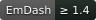
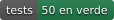
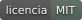
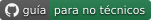
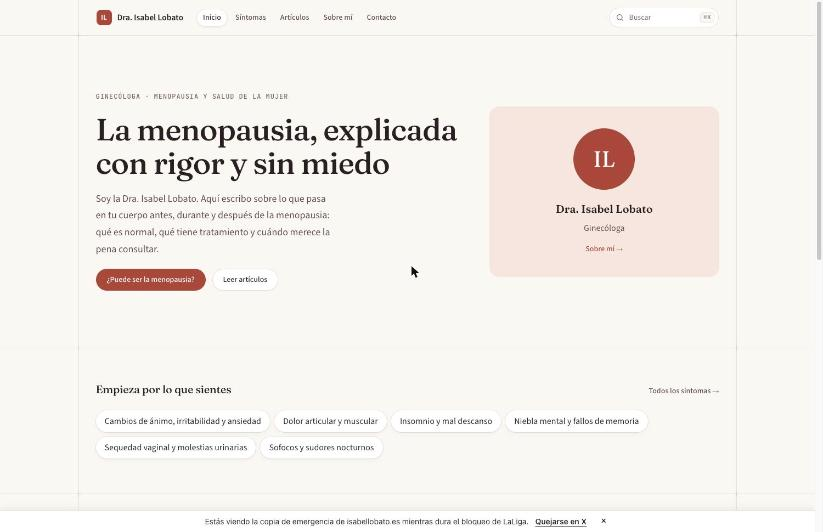
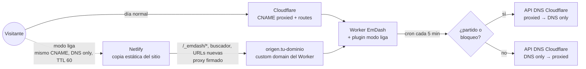
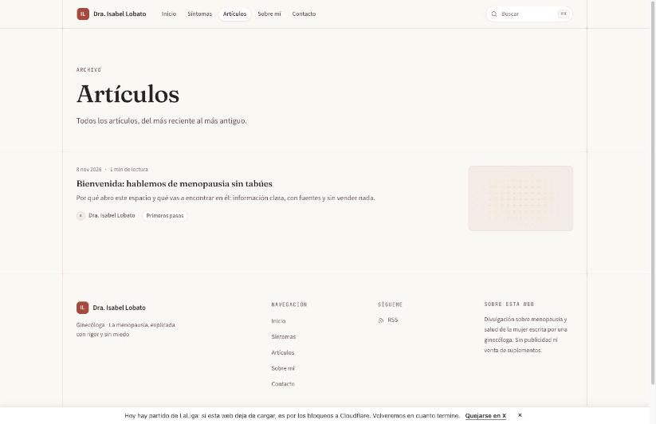
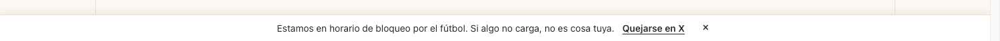
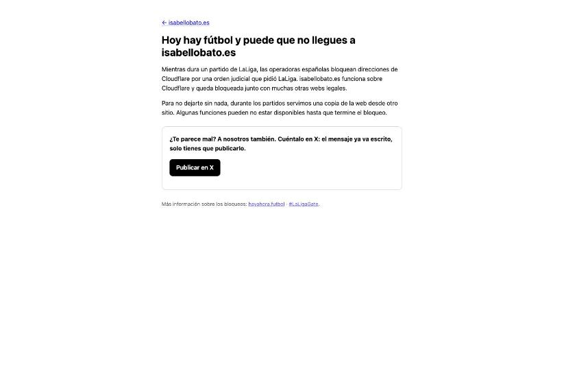

<h1 align="center">emdash-modo-liga</h1>

<p align="center"><b>Tu web sigue abierta cuando hay fútbol.</b><br>
Plugin de <a href="https://emdashcms.com">EmDash CMS</a> para sitios en Cloudflare Workers que, los días de partido de LaLiga, se mudan solos a una copia de emergencia en Netlify y vuelven cuando termina el bloqueo.</p>

<p align="center">
  
  
  
  
  
  <a href="https://noelserdna.github.io/emdash-modo-liga/"></a>
</p>

<p align="center"><a href="https://noelserdna.github.io/emdash-modo-liga/">📖 Guía ilustrada, sin tecnicismos</a> · <a href="./README.en.md">English summary</a> · <a href="#empezar">Empezar</a> · <a href="#la-cli">CLI</a> · <a href="#visto-en-producción">Visto en producción</a></p>

<p align="center"></p>

---

## El problema: España, sábado, 20:59

Desde diciembre de 2024, una sentencia del Juzgado Mercantil nº 6 de Barcelona (310/2024) permite a LaLiga ordenar a las operadoras españolas que **bloqueen direcciones IP** mientras se juegan sus partidos. Las IPs que señala son, en su mayoría, **IPs compartidas de Cloudflare**: detrás de cada una hay miles de webs que no tienen nada que ver con el fútbol. La orden está en vigor hasta el final de la temporada 2026-27.

El resultado, medido en 2026:

| Dato | Fuente |
|---|---|
| 554.507 dominios y 7.441 IPs bloqueados por error entre enero y junio de 2026; Cloudflare, el 90 % de los dominios | [OONI, *LaLiga collateral*](https://ooni.org/post/2026-laliga-collateral) |
| El bloqueo empieza 5-10 minutos antes del partido y termina entre 30 y 75 minutos después, según la operadora | [hayahora.futbol](https://hayahora.futbol), 7-11-2026 |
| Desde una conexión española, la web devuelve la página de la operadora con un certificado inválido, o no carga | Observado en vivo el 8-11-2026 |

Si tu sitio EmDash vive en un Worker de Cloudflare, no tienes «origen» al que redirigir: el Worker **es** el origen y está detrás de las IPs bloqueadas. Las soluciones que existen para WordPress (quitar el proxy naranja y apuntar al servidor propio) aquí no sirven. Hacía falta otra cosa.

## La idea

Mantener una **copia de emergencia en Netlify**, que no aparece en las listas de bloqueo, y mover el dominio allí **solo durante el partido** cambiando una cosa en el DNS de Cloudflare: el registro pasa de *proxied* a *DNS only* y vuelve. Lo dinámico (buscador, panel de administración, MCP, inicio de sesión, URLs que no estén en la copia) sigue funcionando porque la copia lo reenvía **firmado** a un subdominio del Worker que las operadoras no bloquean por nombre.



Un día con partido a las 21:00 se ve así:

| Hora | Qué pasa ahí fuera | Qué hace el plugin |
|---|---|---|
| 20:30 | Nada todavía | Abre la ventana (inicio −30 min): el dominio pasa a Netlify y el banner avisa de que hay partido |
| 20:50-21:05 | Las operadoras empiezan a bloquear las IPs de Cloudflare | Tu web sigue cargando desde Netlify; lo dinámico pasa firmado al Worker |
| 22:50 | Termina el partido | Sigue en modo liga: la cola del bloqueo dura entre 30 y 75 minutos |
| desde 23:00 | hayahora.futbol deja de listar tus IPs | Tras dos lecturas limpias, vuelve a Cloudflare |
| 00:30 | Tope duro (inicio +210 min) | Vuelve sí o sí, aunque hayahora no responda |

Si hay dos partidos seguidos, la cola del primero no se recorta en la pre-ventana del segundo. Entrar en modo liga nunca espera; salir tiene una permanencia mínima de 20 minutos para no ir y venir.

## Qué hace el plugin

- **Calendario.** Lee los horarios de Primera y Segunda de ESPN (sin clave; football-data.org opcional; lista manual) y abre una ventana por partido. Las que se solapan se unen. Un día por tick: cabe en el plan Free de Workers.
- **Detección.** Cruza las IPs de tu sitio con la lista de IPs bloqueadas de hayahora.futbol para recortar la cola y para reaccionar a bloqueos fuera de calendario (noches de Champions). Política `ambas` (por defecto), `calendario` o `deteccion`.
- **DNS.** Cambia tus registros entre *proxied* y *DNS only* con la API de Cloudflare. Solo toca `proxied` y `ttl`; nunca el contenido. Solo acepta como estado normal un registro con proxy: si no lo es, no toca nada y lo dice en el admin.
- **Espejo.** Dispara el *build hook* de Netlify cuando publicas (con *debounce*), cada noche y el día 1 de cada mes para renovar el certificado. El crawler rastrea `origen.<dominio>` con una firma propia, así nunca copia el espejo. Tres modos: `copia-y-proxy`, `proxy-total`, `solo-copia`.
- **Aviso.** Un banner discreto antes del partido, durante el bloqueo y en la copia, y la página `/sin-acceso` del espejo, con un botón para quejarse en X mencionando a @LaLiga y @Cloudflare. Todos los textos se cambian desde el admin.
- **Admin y MCP.** Settings en **Plugins → modo-liga**, estado público en `/_emdash/api/plugins/modo-liga/estado` y herramientas MCP `modo-liga__estado`, `modo-liga__forzar`, `modo-liga__sincronizar` y `modo-liga__tick`.
- **Estrategia `proxy-off`.** Si tu origen no es un Worker (servidor propio detrás del proxy naranja), el mismo motor pasa los registros a *DNS only* hacia tu origen, sin espejo.

<table>
<tr>
<td align="center"><br><sub>Antes del partido</sub></td>
<td align="center"><br><sub>Durante el bloqueo</sub></td>
<td align="center"><br><sub>Lo que no está en la copia</sub></td>
</tr>
</table>

## Visto en producción

El primer sitio que lo usa es [isabellobato.es](https://isabellobato.es). El 8 de noviembre de 2026, con partidos a las 16:15, 18:30 y 21:00, pasó esto desde una conexión española:

| Hora | Qué pasó |
|---|---|
| 18:15 | La operadora empieza a bloquear las IPs del sitio. hayahora.futbol las lista; el dominio devuelve la página nginx de la operadora |
| 18:20 | El plugin, en su primera tarde real, recorta la cola del partido de las 16:15 justo cuando empieza el bloqueo del siguiente. Fallo encontrado y corregido esa misma noche |
| 20:13 | Migración del dominio: el apex y `www` dejan de ser *Custom Domains* del Worker y pasan a `routes` + CNAME con proxy hacia Netlify |
| 20:30 | Primer tick con el token de Cloudflare: los dos registros pasan a *DNS only* |
| 20:36 | isabellobato.es carga de nuevo desde la conexión bloqueada, servida por Netlify. El buscador y el panel funcionan a través del proxy firmado |

Lo que enseñó: la primera tarde con tráfico real vale más que cualquier simulación, y conviene tener el estado público del plugin accesible por el espejo, porque `wrangler tail` no funciona desde España durante un bloqueo.

## Empezar

Necesitas EmDash ≥ 1.4 en Cloudflare Workers, la zona DNS en Cloudflare, una cuenta de Netlify (el plan Free basta) y un repositorio Git. Cuenta unos 30 minutos la primera vez. La [guía ilustrada](https://noelserdna.github.io/emdash-modo-liga/) explica cada paso para quien no programa.

**1. El plugin y el envoltorio del Worker**

```bash
pnpm add emdash-modo-liga
```

```js
// astro.config.mjs
import { modoLiga } from "emdash-modo-liga";

emdash({
  plugins: [
    modoLiga({ dominio: "ejemplo.es", zonaId: "<Zone ID de Cloudflare>" }), // el resto se configura en el admin
  ],
})
```

```ts
// src/worker.ts
import handler, { createScheduledHandler } from "@emdash-cms/cloudflare/worker";
import { withModoLiga } from "emdash-modo-liga";

export default {
  ...withModoLiga(handler, { origenHost: "origen.ejemplo.es", canonicalHost: "ejemplo.es", siteUrlEspejo: "https://mi-espejo.netlify.app" }),
  scheduled: createScheduledHandler(),
} satisfies ExportedHandler;
```

```jsonc
// wrangler.jsonc: el apex y www van por rutas de zona (sus registros DNS los gestiona el plugin);
// origen.<dominio> sí es custom domain: lo usan el espejo y el crawler, siempre con firma.
"routes": [
  { "pattern": "ejemplo.es/*", "zone_name": "ejemplo.es" },
  { "pattern": "www.ejemplo.es/*", "zone_name": "ejemplo.es" },
  { "pattern": "origen.ejemplo.es", "custom_domain": true }
],
"triggers": { "crons": ["* * * * *"] }
```

**2. El espejo en Netlify**

```bash
npx emdash-modo-liga init --dominio ejemplo.es    # crea espejo/: netlify.toml, build.sh, secretos.sh, token-cf.sh, README
```

En Netlify: sitio nuevo enlazado al repo con *base directory* `espejo`, dominios `ejemplo.es` y `www.ejemplo.es` (avisará de que el DNS no apunta allí: es lo esperado), un *build hook* y, si el equipo tiene SSO, desactivarlo. El resto de variables ya va en `netlify.toml`.

**3. Secretos, sin que pasen por la pantalla**

```bash
bash espejo/secretos.sh <Project ID de Netlify>      # MODO_LIGA_FIRMA en el Worker y ESPEJO_FIRMA en Netlify, mismo valor aleatorio
npx wrangler secret put MODO_LIGA_BUILD_HOOK          # URL del build hook
bash espejo/token-cf.sh ~/.cf-token <Project ID> <Zone ID>   # token de Cloudflare → Worker (MODO_LIGA_CF_TOKEN) y Netlify (CF_Token, CF_Zone_ID)
```

El token se crea en Cloudflare (*My Profile → API Tokens → Create Token → Custom*) con **Zone → DNS → Edit** y **Zone → Zone → Read**, limitado a tu zona, y se guarda en un fichero solo tuyo (`umask 077`). Wrangler no puede editar DNS por sí mismo: su sesión no incluye ese permiso.

**4. Los registros DNS «normales»**

```bash
npx emdash-modo-liga dns --dominio ejemplo.es --espejo mi-espejo.netlify.app --token-fichero ~/.cf-token            # muestra el plan
npx emdash-modo-liga dns --dominio ejemplo.es --espejo mi-espejo.netlify.app --token-fichero ~/.cf-token --aplicar  # lo ejecuta
```

Deja `CNAME ejemplo.es → mi-espejo.netlify.app` y `CNAME www → mi-espejo.netlify.app`, ambos con proxy. Con las `routes`, el Worker atiende todo; el CNAME solo importa cuando el plugin quita el proxy. Si el sitio ya estaba publicado con el apex y `www` como *Custom Domains*, el orden es: cambiar esas entradas por las `routes`, `pnpm deploy` (borra los Custom Domains y sus registros) y, acto seguido, `dns --aplicar`. Entre ambos pasos el dominio queda unos segundos sin registro: hazlo fuera de una ventana de partido.

**5. Certificado del espejo**

Netlify no puede emitir el certificado de Let's Encrypt mientras el DNS apunte a Cloudflare, así que el espejo usa uno propio. La tarea `cert` del `build.sh` (DNS-01 con acme.sh y el token anterior) lo emite y lo sube a Netlify; el plugin la dispara el día 1 de cada mes. Para la primera vez: `curl -X POST -d '{"tarea":"cert"}' <build hook>`.

**6. Ensayo**

Desde el admin (o con la tool MCP `modo-liga__forzar`), `forzar: on` fuera de partido, comprobar con `dig +short ejemplo.es` que el dominio apunta a Netlify y que el panel sigue entrando por `https://ejemplo.es/_emdash/admin`, y volver a `auto`.

## La CLI

| Comando | Para qué |
|---|---|
| `emdash-modo-liga init --dominio … [--modo … --paquete …]` | Genera la carpeta `espejo/` para Netlify |
| `emdash-modo-liga dns --dominio … --espejo … [--aplicar --reemplazar --zona …]` | Crea o comprueba los CNAME con proxy (estado normal). Simula por defecto |
| `emdash-modo-liga crawl --origen … --sitio … [--modo …]` | Hace la copia estática (la ejecuta el build de Netlify) |
| `emdash-modo-liga aviso --sitio …` | Solo la página `/sin-acceso`, sin copia (cuando falta la firma) |
| `emdash-modo-liga netlify-toml --dominio …` | Imprime el `netlify.toml` generado |

## Comprobar

```bash
curl -s https://ejemplo.es/_emdash/api/plugins/modo-liga/estado | jq    # estado público: activo, motivo, ventana, próxima
curl -sI https://origen.ejemplo.es/                                      # 404 sin firma: el origen no se expone
curl -sI https://mi-espejo.netlify.app/ | grep x-modo-liga               # x-modo-liga-espejo: 1 en la copia; -origen: 1 en lo proxiado
```

Durante un bloqueo, el estado también se lee por el espejo (`https://mi-espejo.netlify.app/_emdash/api/plugins/modo-liga/estado`), porque las IPs de Cloudflare no responden desde España.

## Limitaciones conocidas

- Netlify no es inmune (se quejó en mayo de 2025), pero no aparece en los datos de OONI de 2026. Si cae durante un partido no hay plan C salvo un VPS (driver `webhook` y las plantillas de GitHub Actions).
- Firebase Hosting, Vercel (no Enterprise) y GitHub Pages **no sirven** como espejo con cambio de DNS: no admiten certificado propio.
- Durante una ventana Google también ve el espejo. La copia conserva canonical, sitemap y robots, y las URLs nuevas se sirven por proxy.
- hayahora.futbol y la API de ESPN no tienen SLA. Ante un fallo se mantiene el último estado conocido y se registra.
- Cada cambio de DNS tarda hasta cinco minutos en llegar a todos los resolutores.

## Quéjate (de verdad ayuda)

El plugin pone el problema delante de cada visitante y le da un botón para publicar en X mencionando a @LaLiga y @Cloudflare. Hay más: la campaña [#LaLigaGate](https://laligagate.com) recoge casos y explica cómo denunciar ante la Comisión Europea, y [hayahora.futbol](https://hayahora.futbol) mide los bloqueos operadora a operadora.

## Créditos

Nace del «modo liga» de [desarrollomcp.com](https://dev.to/noelserdna/bloqueos-de-laliga-a-cloudflare-como-seguimos-abiertos-con-mcp-4ing), en producción desde octubre de 2026. Datos de [OONI](https://ooni.org/post/2026-laliga-collateral) y [hayahora.futbol](https://hayahora.futbol). Inspirado por [bypass-laligagate](https://github.com/fernandotellado/bypass-laligagate) (WordPress). Licencia MIT.
